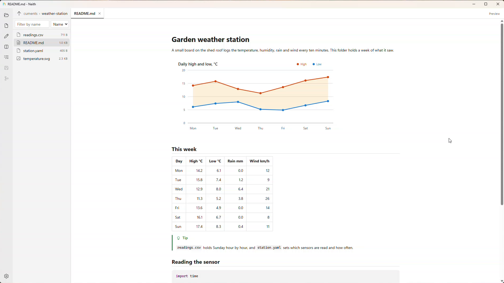

# Neith

A small Windows app for viewing and editing the files you open every day:
markdown rendered beside a list of its folder, with a plain-text editor
that highlights markdown, JSON, YAML, PowerShell and other languages, and
follows the Windows light or dark theme.



A 1:22 tour, with no sound:

https://github.com/user-attachments/assets/f31e7a15-09bf-405e-9c79-74ab4a95b2d6

And 1:02 of Git and history: a branch's commits, a copy kept at every
save, compare and restore:

https://github.com/user-attachments/assets/94b063ea-aa8b-47f2-ace9-198a011fe0aa

This repository holds Neith's installers and update feed only.

## What it opens

Any UTF-8 text file up to 20 MB opens in the editor. Preview shows
these as more than text:

| Files | Preview |
| --- | --- |
| Markdown (`.md`, `.markdown`) | rendered, with frontmatter as a card, code blocks highlighted and images shown |
| JSON, YAML, TOML | a collapsible tree |
| CSV, TSV | a table |
| TMDL | an outline of its tables, columns, measures and other objects |
| PNG, JPEG, GIF, WebP, AVIF, BMP, ICO | the picture, to zoom and pan |
| SVG | the picture, and its source in edit mode |
| PDF | WebView2's built-in PDF viewer |

Any other text file previews as its source, highlighted where Neith knows
the language: DAX, KQL, Power Query M, TMDL and Bicep among them. The
editor underlines syntax errors in JSON, YAML, TOML, Python, JavaScript,
CSS, Rust, Go, PHP and XML. With a language server installed, it also
underlines the problems that server finds, once you allow it for the
folder:

| Files | Language server |
| --- | --- |
| Python | [Pyright](https://github.com/microsoft/pyright) or [Ruff](https://docs.astral.sh/ruff/) |
| TypeScript, JavaScript | [typescript-language-server](https://github.com/typescript-language-server/typescript-language-server) |
| Shell scripts | [bash-language-server](https://github.com/bash-lsp/bash-language-server), with [ShellCheck](https://www.shellcheck.net/) |
| YAML | [yaml-language-server](https://github.com/redhat-developer/yaml-language-server) |

A file Neith can't show, such as a sound, a video or an Office
document, offers **Open in default app**, as a file's right-click menu
does. It opens only what Windows takes for a picture, a sound, a video
or a document, never a program, a shortcut or a script.

## Install

1. Open the [latest release](https://github.com/wardawgmalvicious/neith-releases/releases/latest)
   and download `Neith_<version>_x64-setup.exe`.
2. Run it. It installs for your Windows account only, so it needs no
   administrator rights.

The installer isn't code-signed yet, so Windows SmartScreen may show
**Windows protected your PC**. Choose **More info**, check that the
publisher line reads *Unknown publisher* and the file is the one you
downloaded from this page, then choose **Run anyway**.

Neith needs Windows 10 or 11 (x64) and the Microsoft Edge WebView2
runtime, which Windows 11 includes. If it's missing, the installer
downloads it.

## Check your download

With no code signature, the check that a setup.exe is the one published
here is GitHub's: each release is immutable, and GitHub records an
attestation of its files when it's published. With the
[GitHub CLI](https://cli.github.com/), check a downloaded file against
it:

```powershell
gh release verify-asset (Resolve-Path .\Neith_*_x64-setup.exe) -R wardawgmalvicious/neith-releases
```

Run it in the folder that holds the download, with one Neith setup in
it. It checks the file against the latest release; for an older
release's file, put that release's tag before the path, as in
`gh release verify-asset v0.5.0 <path> -R <repo>`.
`gh release verify -R wardawgmalvicious/neith-releases` checks the latest
release itself and lists each file's SHA-256.

Without the CLI, the release page shows **Immutable** under its title and
each file's SHA-256 beside it. Compare that with the file's own:

```powershell
Get-FileHash .\Neith_*_x64-setup.exe
```

## Updates

Neith checks this repository when it starts and offers each new version.
Installing one closes Neith, after asking about any unsaved changes.

Every release here is immutable: once published, its files can't be
changed or replaced.

## What Neith connects to

- **This repository, for updates.** At each start, and when you choose
  **Check for updates** in Settings, Neith downloads the latest release's
  `latest.json`, signed in to nothing. Installing an update downloads its
  setup.exe and signature from the same release, and Neith checks the
  signature before it runs the setup.
- **Images a markdown file embeds from the web.** Previewing a file that
  shows an `https://` image fetches it from its host, as a browser would.
  `http://` images aren't loaded.
- **Links you click** open in your default browser.

Neith sends nothing else: no account, no usage data, no crash reports.
The programs it runs aren't Neith's, and what they send is theirs to
say:

- **The WebView2 runtime** that draws its window, which is Microsoft's
  and updates itself.
- **A language server** you've installed and said yes to for a folder.
  yaml-language-server downloads SchemaStore's catalog and the schema it
  lists for a file's path, such as a GitHub workflow's, and Kubernetes'
  custom resource schemas, unless **Fetch schemas for YAML files** is
  off in Settings; a schema a YAML file names itself is fetched either
  way. Neith turns off typescript-language-server's download of `@types`
  packages.
- **Claude Code**, in a terminal, when you choose **Ask Claude about this
  file** on a file's right-click menu.
- **A file's default app**, when you choose **Open in default app**.

## Uninstall

Settings > Apps > Installed apps > Neith > Uninstall.

## Report a problem

Ask in [Q&A](https://github.com/wardawgmalvicious/neith-releases/discussions/categories/q-a)
with the Neith version, your Windows version and the steps that lead to
the problem.

Report a security problem privately instead, as [SECURITY.md](SECURITY.md)
says.
